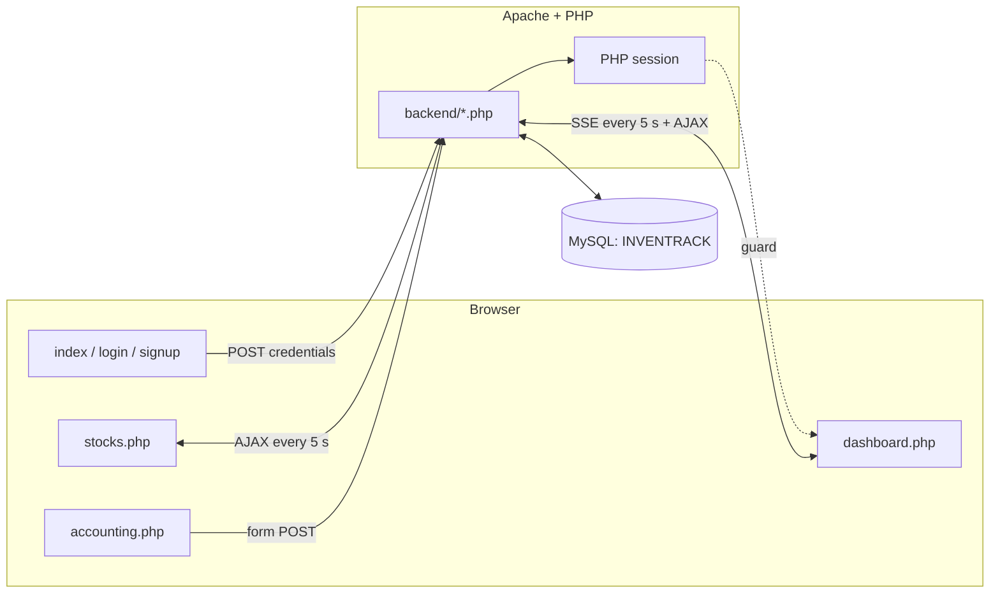

<h1 align="center">Inventrack</h1>

<p align="center">
  Stock counts, reorder alerts, and an expense ledger in one place.
</p>

<p align="center">
  <a href="#requirements"></a>
  <a href="#database"></a>
  <a href="#installation"></a>
</p>

## Contents

- [Overview](#overview)
- [How it works](#how-it-works)
- [Requirements](#requirements)
- [Repository layout](#repository-layout)
- [Installation](#installation)
- [Database](#database)
- [Configuration](#configuration)
- [Usage](#usage)
- [Backend endpoints](#backend-endpoints)
- [Status and limitations](#status-and-limitations)
- [License](#license)

## Overview

Inventrack gives a shop owner one place to see what is on the shelves, what is
running out, and what money is owed. Stock rows live in a MySQL table, the
browser polls the server every five seconds, and the pages redraw themselves
without a reload.

| Capability     | Description                                                                                                       |
| -------------- | ----------------------------------------------------------------------------------------------------------------- |
| Stock register | One card per shelf tray, with item name, SKU, price, supplier, quantity and image                                 |
| Stock status   | Quantity is compared against a per-item warning threshold and shown as in stock, low stock or out of stock        |
| Live refresh   | Stock cards poll every five seconds; the dashboard uses a server-sent event stream on the same interval           |
| Dashboard      | Stock overview list, bar chart of quantity per item, transaction feed, and a wallet total of quantity times price |
| Accounting     | Add, edit and delete expense entries with a category, an amount and a paid, pending or unpaid status              |
| Reordering     | Each card carries a supplier link and an ORDER NOW button that opens it in a new tab                              |
| Accounts       | Sign up and sign in on username, business name and password, with the password stored as a `password_hash` digest |
| Images         | Item photos are uploaded to `backend/stockimg/` and referenced by path                                            |

Quantity itself is not entered through the interface. `itemsdb.computedQuantity`
is read everywhere and written nowhere in this repository, so it is fed by
whatever measures the trays; see [Database](#database).

## How it works



Every page is server-rendered PHP with jQuery on top. There is no framework, no
router and no build step: Apache serves the files, each script opens its own
`mysqli` connection, and the browser talks to `backend/` with jQuery AJAX.

Two refresh styles are in use. `stocks.php` calls `fetch_stocks.php` on a
`setInterval` and rebuilds its cards; `dashboard.php` opens an `EventSource`
against `fetchdatadash.php`, which holds the request open and pushes the whole
`itemsdb` table every five seconds. The chart, the stock list and the wallet
figure are all derived from that one payload.

Sign-in state is a PHP session. `dashboard.php` redirects to `login.html` when
`$_SESSION['username']` is missing; the other inner pages do not check.

## Requirements

| Category | Requirement                                                                          |
| -------- | ------------------------------------------------------------------------------------ |
| Server   | Apache with PHP 8 and the `mysqli` and `pdo_mysql` extensions. XAMPP ships all of it |
| Database | MySQL or MariaDB, reachable on `localhost`                                           |
| Browser  | Any modern browser; server-sent events and ES6 template literals are used            |
| Network  | Internet access on first load, for the jQuery, Chart.js and Google Fonts CDNs        |

## Repository layout

```
inventrackweb/
|-- index.html                landing page, sign up / log in
|-- login.html                sign in form
|-- signup.html               registration form
|
|-- dashboard.php             stock overview, chart, transactions, wallet
|-- stocks.php                stock cards, add / edit / delete item
|-- accounting.php            expense table with add and edit modals
|-- settings.php              profile panel and sign out
|-- header.php                shared nav bar, highlights the current page
|-- image.php                 serves an item image as a base64 data URI
|
|-- *.css                     one stylesheet per page, plus header.css
|-- assets/                   logo, icons, placeholder art
|
|-- backend/
|   |-- login.php             verify credentials, open session
|   |-- signup.php            create account
|   |-- logout.php            destroy session
|   |-- fetch_stocks.php      itemsdb as JSON
|   |-- fetchdatadash.php     itemsdb as a server-sent event stream
|   |-- fetch_data.php        same stream, unused duplicate
|   |-- getdata.php           first itemsdb row as JSON
|   |-- newitem.php           create blank tray rows
|   |-- update_stock.php      update a tray, with optional image upload
|   |-- delete.php            delete a tray, reset AUTO_INCREMENT
|   |-- get_accounting.php    transactions as JSON, newest first
|   |-- populateaccounting.php  server-rendered accounting rows
|   |-- add_entry.php         insert an accounting entry
|   |-- edit_entry.php        update an accounting entry
|   |-- delete_entry.php      delete an accounting entry
|   `-- stockimg/             uploaded item images
|
`-- dashboard.html            static design mockups of the four inner pages,
    stocks.html               kept from the layout phase; the .php files are
    accounting.html           what actually runs
    settings.html
```

## Installation

The app expects to be served from `http://localhost/inventrackweb/`. Several
redirects are absolute (`/inventrackweb/dashboard.php`), so the folder name
matters.

1. **Get the files into the web root.**

   ```bash
   cd /c/xampp/htdocs
   git clone https://github.com/EagleStelle/inventrackweb.git
   ```

2. **Start Apache and MySQL** from the XAMPP control panel.

3. **Create the database.** Open <http://localhost/phpmyadmin>, create a
   database named `INVENTRACK`, and run the schema in
   [Database](#database).

4. **Open the app** at <http://localhost/inventrackweb/>, register an account,
   then sign in.

No dependencies are installed and nothing is compiled. jQuery and Chart.js are
loaded from a CDN at runtime.

## Database

The schema is not checked in. These are the tables and columns the code reads
and writes, which is what the app needs in order to run.

```sql
CREATE DATABASE IF NOT EXISTS INVENTRACK;
USE INVENTRACK;

CREATE TABLE users (
  id            INT AUTO_INCREMENT PRIMARY KEY,
  username      VARCHAR(64)  NOT NULL,
  business_name VARCHAR(128) NOT NULL,
  password      VARCHAR(255) NOT NULL          -- password_hash digest
);

CREATE TABLE itemsdb (
  trayNo           INT AUTO_INCREMENT PRIMARY KEY,
  itemName         VARCHAR(128),
  SKU              VARCHAR(64),
  price            DECIMAL(10,2),
  warningquant     INT,                        -- low-stock threshold
  supplier         VARCHAR(128),
  supplierlink     VARCHAR(255),
  ItemImg          VARCHAR(255),               -- path under backend/
  offset           INT DEFAULT 0,
  computedQuantity INT DEFAULT 0               -- current stock, written externally
);

CREATE TABLE accounting (
  id         INT AUTO_INCREMENT PRIMARY KEY,
  name       VARCHAR(128) NOT NULL,
  category   VARCHAR(64)  NOT NULL,
  status     ENUM('PAID','PENDING','UNPAID') NOT NULL,
  amount     DECIMAL(10,2) NOT NULL,
  created_at TIMESTAMP DEFAULT CURRENT_TIMESTAMP
);
```

Two columns are worth calling out. `computedQuantity` drives the entire stock
display and the wallet total, but no script here updates it, so rows stay at
their default until something outside the app writes to them. `offset` is set
to `0` when a tray is created and is never read again.

`ItemImg` is also read two different ways: `update_stock.php` stores a file
path and the stock cards load it as `./backend/<path>`, while `image.php`
treats the same column as an image BLOB. Only the path form is wired into the
pages.

## Configuration

There is no configuration file. The connection details are repeated inline in
all 16 PHP scripts that touch the database:

```php
$servername = "localhost";
$username   = "root";
$password   = "";
$dbname     = "INVENTRACK";
```

Those are the XAMPP defaults. Moving to another database means editing every
one of them, so the first refactor worth doing is a single `backend/db.php`
that the rest of the scripts include. Two files already expect one —
`add_entry.php` and `delete_entry.php` call `include 'database.php'`, a file
that is not in the repository, and they work only because each opens its own
connection beforehand.

The app root is likewise hardcoded, in the absolute redirects listed under
[Installation](#installation).

## Usage

1. Open the landing page and choose **Sign Up**. Register with a username, a
   business name and a password, then log in with the same three values.
2. **Dashboard** shows the business name and owner, a wallet figure summing
   quantity times price across items in stock, a stock overview list, the
   quantity-per-item bar chart, and the newest accounting entries.
3. **Stocks** lists one card per tray. Press **+** and enter a count to create
   that many blank trays.
4. Press the pencil on a card to edit its name, SKU, price, warning quantity,
   supplier and supplier link, or to upload a photo. **Delete** in the same
   modal removes the tray.
5. A card turns orange at or below its warning quantity and red at zero.
   **ORDER NOW** opens the supplier link in a new tab.
6. **Accounting** keeps the expense ledger. **+** adds an entry; the pencil and
   cross on each row edit and delete it.
7. **Settings** holds the profile panel and **Sign Out**.

## Backend endpoints

| Endpoint                     | Method | Purpose                                                                    |
| ---------------------------- | ------ | -------------------------------------------------------------------------- |
| `backend/signup.php`         | POST   | Hash the password, insert the user, return to the landing page             |
| `backend/login.php`          | POST   | Match username and business name, verify the password, open the session    |
| `backend/logout.php`         | GET    | Destroy the session                                                        |
| `backend/fetch_stocks.php`   | GET    | All of `itemsdb` as JSON                                                   |
| `backend/fetchdatadash.php`  | GET    | `text/event-stream`, pushes `itemsdb` every 5 s                            |
| `backend/getdata.php`        | GET    | First `itemsdb` row as JSON                                                |
| `backend/newitem.php`        | POST   | Runs the SQL passed in `query`; see [limitations](#status-and-limitations) |
| `backend/update_stock.php`   | POST   | Multipart update of one tray, image optional                               |
| `backend/delete.php`         | POST   | Delete tray `id`, then realign `AUTO_INCREMENT`                            |
| `backend/get_accounting.php` | GET    | Transactions as JSON, newest first, dates preformatted                     |
| `backend/add_entry.php`      | POST   | Insert an accounting entry                                                 |
| `backend/edit_entry.php`     | POST   | Update accounting entry `id`                                               |
| `backend/delete_entry.php`   | GET    | Delete accounting entry `id`                                               |
| `image.php`                  | GET    | `?trayNo=` returns `ItemImg` as a base64 data URI                          |

## Status and limitations

This is a working prototype from a course project, not a hardened application.
It is safe on a local XAMPP install; it is not ready to face a network. The
known gaps, in rough order of severity:

- `backend/newitem.php` executes whatever SQL arrives in the `query` POST
  field. Any visitor can run arbitrary statements against the database.
- `add_entry.php`, `edit_entry.php` and `delete_entry.php` interpolate POST and
  GET values straight into their SQL and are open to injection. The stock and
  auth scripts use prepared statements.
- Only `dashboard.php` checks the session. `stocks.php`, `accounting.php`,
  `settings.php` and every `backend/` endpoint answer unauthenticated requests.
- Nothing is scoped per account. All users share one `itemsdb` and one
  `accounting` table.
- `update_stock.php` accepts an uploaded file without checking type or size.
- Session values are echoed into the dashboard without escaping.

Unfinished interface work:

- The filter buttons on the stocks and accounting pages, the search boxes, and
  the settings dropdown items are placeholders with no handler behind them.
- The dashboard's "Overall Inventory" verdict is the literal string `Bad`, and
  the settings profile shows `Shop Name` / `Owner Name` rather than the
  session values.
- `stocks.php` binds a click handler to a missing `#add-button` element, which
  throws in the console on every load.
- `backend/fetch_data.php` duplicates `fetchdatadash.php` and is unreferenced.

## License

No license file is present in this repository, so default copyright applies and
the code is not licensed for reuse. Add a `LICENSE` file to change that.
Copyright (c) 2026 [EagleStelle](https://github.com/EagleStelle).
